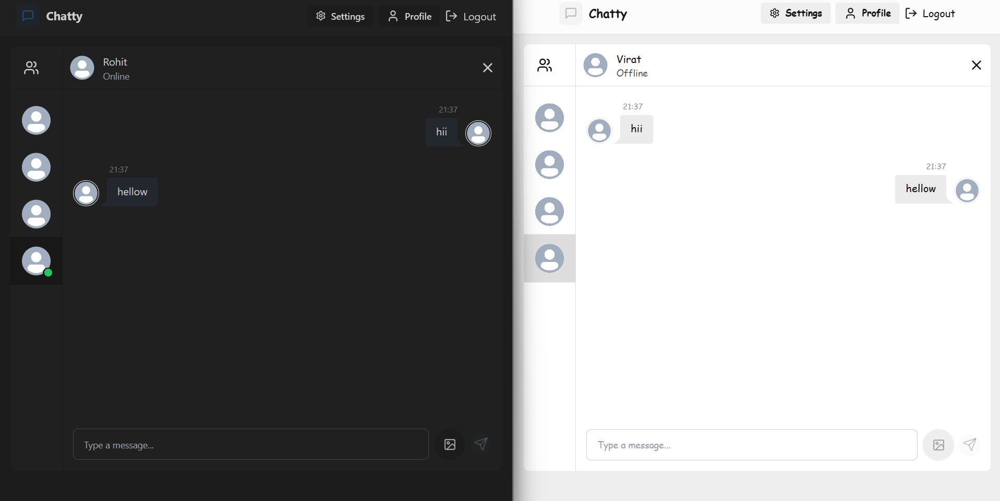
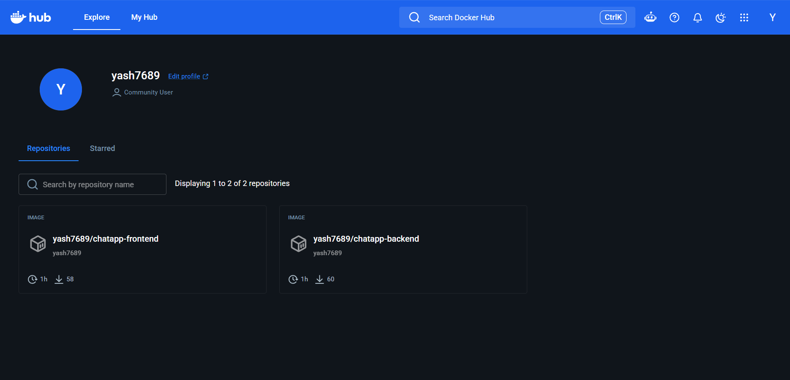
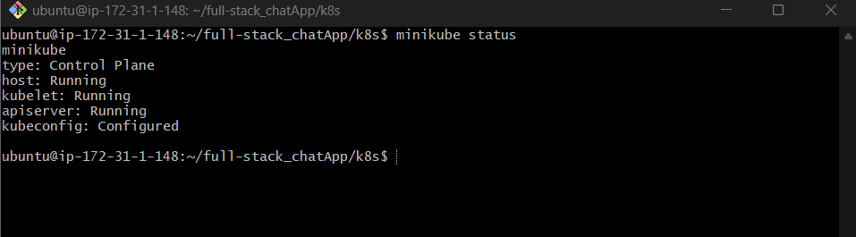
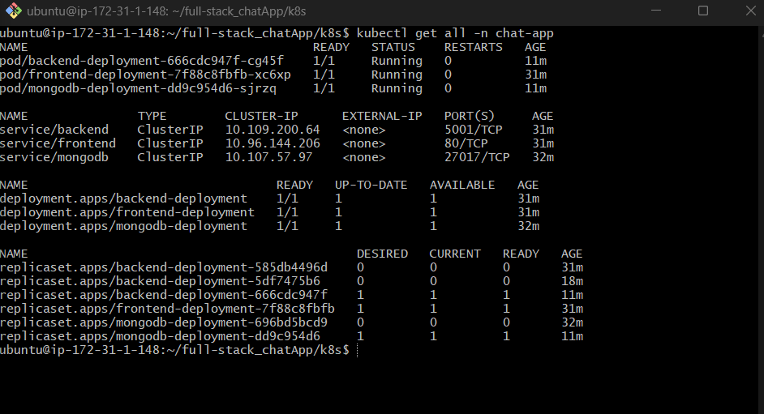
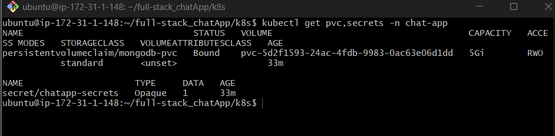
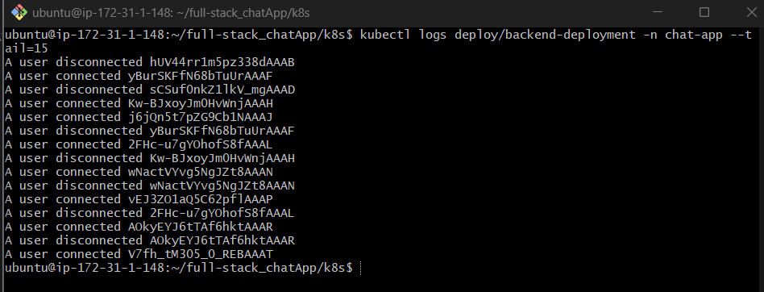

# kubernetes-minikube-chatapp
Real-time chat app (React, Node.js, MongoDB) containerized with Docker and deployed on Kubernetes using Minikube on AWS EC2

# Full-Stack Chat App on Kubernetes (Minikube on AWS EC2)

A real-time chat application ("Chatt") containerized with Docker, pushed to Docker Hub, and deployed on a Minikube Kubernetes cluster running on an AWS EC2 Ubuntu instance.



> The application source code and the original manifests come fromgithub. This repository documents my own build, deployment and troubleshooting of that app on Kubernetes.

## Architecture

```

```

| Component | Image | Port | Kubernetes objects |
|---|---|---|---|
| Frontend (React build served by nginx) | `yash7689/chatapp-frontend` | 80 | Deployment + Service |
| Backend (Node.js, Express, Socket.io) | `yash7689/chatapp-backend:latest` | 5001 | Deployment + Service |
| Database (MongoDB) | `mongo:latest` | 27017 | Deployment + Service + PVC |

- All resources live in the `chat-app` namespace.
- The frontend's nginx proxies `/api` and `/socket.io` to the `backend` service inside the cluster.
- The backend reaches MongoDB through the `mongodb` service name.
- The JWT secret is stored in a Kubernetes `Secret`.

## Tech used

Docker, Docker Hub, Kubernetes, Minikube, kubectl, AWS EC2 (Ubuntu), nginx, Node.js, MongoDB

## Project structure

```
.
├── k8s/
│   ├── namespace.yml
│   ├── secrets.yml
│   ├── mongodb-pv.yml
│   ├── mongodb-pvc.yml
│   ├── mongodb-deployment.yml
│   ├── mongodb-service.yml
│   ├── backend-deployment.yml
│   ├── backend-service.yml
│   ├── frontend-deployment.yml
│   ├── frontend-service.yml
│   └── ingress.yml          (not used in this setup)
├── screenshots/
└── README.md
```

## Prerequisites

- An AWS EC2 Ubuntu instance with at least 2 vCPUs and 2 GB RAM (for example t3.small or larger)
- Docker, Minikube and kubectl installed
- A Docker Hub account
- Inbound TCP 8081 allowed in the EC2 security group

## Steps

### 1. Build and push the images

```bash
git clone https://github.com/LondheShubham153/full-stack_chatApp.git
docker login -u yash7689

cd full-stack_chatApp/backend
docker build -t yash7689/chatapp-backend:latest .
docker push yash7689/chatapp-backend:latest

cd ../frontend
docker build -t yash7689/chatapp-frontend:latest .
docker push yash7689/chatapp-frontend:latest
```



### 2. Start the cluster

```bash
sudo usermod -aG docker $USER && newgrp docker
minikube start --driver=docker
minikube status
```



### 3. Deploy to Kubernetes

```bash
cd k8s
kubectl apply -f namespace.yml
kubectl apply -f secrets.yml -f mongodb-pv.yml -f mongodb-pvc.yml -f mongodb-deployment.yml -f mongodb-service.yml
kubectl apply -f backend-deployment.yml -f backend-service.yml
kubectl apply -f frontend-deployment.yml -f frontend-service.yml
kubectl get all -n chat-app
```

All three pods should show `Running` with `1/1` ready.





### 4. Access the app

```bash
kubectl port-forward -n chat-app --address 0.0.0.0 svc/frontend 8081:80
```

Open `http://<EC2-public-IP>:8081`. Sign up two users in two different browsers (or a normal and an incognito window) to test real-time messaging.

Backend logs confirm MongoDB is connected and socket clients are connecting:

```bash
kubectl logs deploy/backend-deployment -n chat-app --tail=15
```



## Problems faced and how I fixed them

| Problem | Cause | Fix |
|---|---|---|
| `minikube start` failed with `DRV_NOT_HEALTHY` and `permission denied ... docker.sock` | My user was not in the `docker` group | `sudo usermod -aG docker $USER`, then `newgrp docker` |
| Deployments would have failed to pull images | Manifests pointed to the original author's Docker Hub images | Pointed the Deployments to my own images (`yash7689/...`) |
| Port-forward failed with `address already in use` | An old port-forward was still holding port 8080 | Killed it and used port 8081 |
| Browser showed `refused to connect` | URL typed as `ip/8081` instead of `ip:8081` | Used `http://<ip>:8081` |
| Login worked but no users or messages appeared | The backend sets the auth cookie with `secure: true` when `NODE_ENV=production`, and browsers drop Secure cookies over plain HTTP | Set the backend `NODE_ENV` to `development` for this HTTP-only demo (a real deployment should use HTTPS) |
| MongoDB data lost on pod restart | The volume was defined but never mounted | Added `volumeMounts` (`/data/db`) to the MongoDB Deployment |

## What I learned

- Debugging Kubernetes with `kubectl get`, `describe`, `logs` and `exec`
- How Services, namespaces, Secrets and PVCs fit together
- Why cookie flags matter when serving an app over plain HTTP
- Running a local Kubernetes cluster on a cloud VM and exposing it with port-forward

## Future improvements

- Serve the app over HTTPS with an Ingress and TLS, then restore `NODE_ENV=production`
- Move the MongoDB username and password into a Kubernetes Secret instead of plain values in the Deployment
- Add liveness and readiness probes and resource limits to every container
- Deploy the same manifests on Amazon EKS with a load balancer
- Add a CI/CD pipeline to build, push and deploy automatically

## Cleanup

```bash
kubectl delete namespace chat-app
minikube delete
```

Then stop or terminate the EC2 instance and release any Elastic IP or EBS volume to avoid charges.

## Notes

- `ingress.yml` is included from the original project but was not used; the frontend nginx handles routing.
- The JWT value in `secrets.yml` is a demo value from the original project. Never commit real secrets to a public repo.
